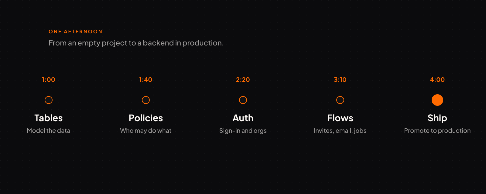
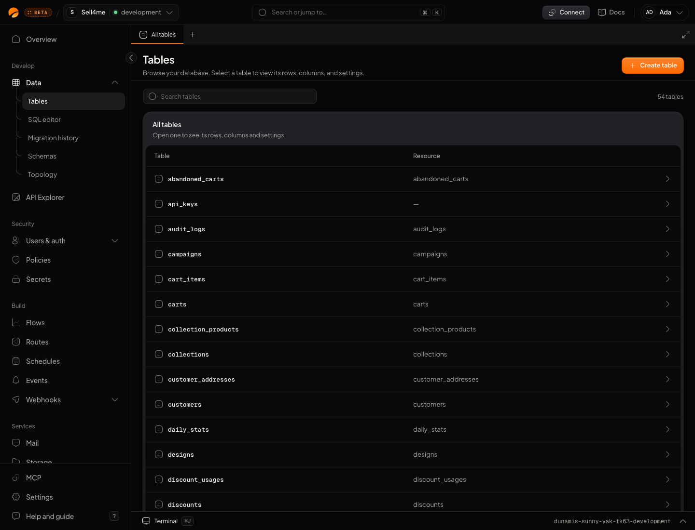
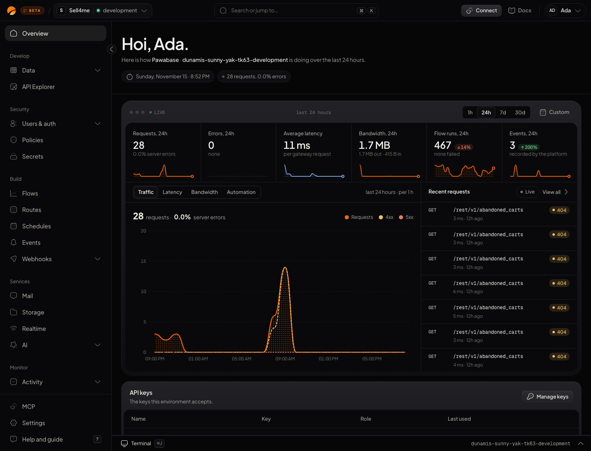

Most SaaS products need the same backend, and most teams spend their first month building it: a database, an API, sign-in, teams
and roles, invitations, transactional email, a few background jobs, and some way to tell staging from production.

On Pawabase that's an afternoon. Not a toy version of it, the real thing: the backend you'd still be happy with at your thousandth
customer. In this guide we'll build one for **Taskflow**, a small project-management SaaS where companies sign up, invite their
team, and manage projects and tasks together.



Here's what we'll have by the end:

- **Data:** projects and tasks, each belonging to a company, with an API for both.
- **Security:** one access rule that keeps every company's data its own.
- **Sign-in:** email and password, passkeys and multi-factor authentication, with companies, roles and invitations.
- **Automation:** a welcome email, an email when a task is assigned, and a weekly digest.
- **Production:** staging and production environments, with changes promoted after a review.

Grab a coffee. Let's build.

## 1:00 · Model the data

Create a project in [Pawabase Cloud](https://dashboard.pawabase.com/signup) and open **Studio**. Every project starts with a
development environment, which is where we'll work.

In **Tables**, create two:

| Table | Columns |
| --- | --- |
| `projects` | `name` (text), `org_id` (the company it belongs to), `archived` (boolean) |
| `tasks` | `title` (text), `project` (link to projects), `org_id`, `assignee` (a user), `status` (text), `due_on` (date) |



That's it for the API. Each table already has a REST endpoint with filters, relations, full-text search and pagination, and the
**API Explorer** lets you try every call in the browser. Each change you make is recorded as a migration in **Migration history**,
which you can read and roll back.

Connect your front end with the SDK. Studio's **Connect** button writes the setup for your framework. For a React app:

```ts title="src/pawabase.ts"
import { createClient } from "@pawabase/client";

export const pawabase = createClient({
  url: import.meta.env.VITE_PAWABASE_URL,
  project: import.meta.env.VITE_PAWABASE_PROJECT,
  apiKey: import.meta.env.VITE_PAWABASE_KEY, // a publishable key: safe in the browser, your rules decide what it can do
});
```

Reading and writing is one line each:

```ts title="src/tasks.ts" {4-8}
import { pawabase } from "./pawabase";

// open tasks, with their project attached
const { data: tasks } = await pawabase
  .from("tasks")
  .where({ status: "open" })
  .expand("project")
  .perPage(20);

// a project, a task in it, and the task done
const project = await pawabase.from("projects").create({ name: "Launch" });
const task = await pawabase.from("tasks").create({ title: "Write the launch post", project: project.id, status: "open" });
await pawabase.from("tasks").update(task.id, { status: "done" });
```

<Callout type="note" title="Typed from your schema">
  Pawabase can generate TypeScript types from your tables, so `tasks` above is fully typed: the wrong column name is a compile error,
  not a bug report.
</Callout>

## 1:40 · Decide who may do what

A multi-tenant SaaS lives or dies on one rule: **a company's data is only ever seen by that company.** Most platforms make you write
that rule again and again: once per table, then for files, then for realtime channels.

In Pawabase you write it once. Open **Policies** and create one called `team_member`: *signed in, and a member of the organization
the row belongs to.* Then attach it:

- on `projects` and `tasks`, for reading and writing;
- a stricter `team_admin` (the same, with the role owner or admin) for deleting projects;
- on the storage bucket where task attachments live;
- on the realtime channels that push task updates to the board.

That's the whole security model of the product: two named rules, used everywhere. When you add a third table next month, you
attach `team_member` and you're done. Simple checks like this are pushed down into the database query, so they stay fast as your
tables grow.

## 2:20 · Sign-in, companies and invitations

Turn on the sign-in methods you want in **Users & auth**: email and password, passkeys, and Google or GitHub. Require
multi-factor authentication for admins if you like. In your app:

```ts title="src/auth.ts"
import { pawabase } from "./pawabase";

export async function signUp(email: string, password: string) {
  return pawabase.auth.signUp({ email, password });
}

export async function signIn(email: string, password: string) {
  const result = await pawabase.auth.signInWithPassword({ email, password });
  // people with a second factor confirm it before the session starts
  if (result.status === "mfa_required") await result.verify(prompt("Your code") ?? "");
  return result;
}
```

Now the part that usually takes a week: **companies**. In Pawabase they're built into authentication as **organizations**. Your sign-up
flow creates the company's organization and its creator becomes the owner; owners and admins invite colleagues by email; and a
company can verify its email domain so colleagues join automatically. Roles and permissions are yours to define (owner,
admin, member, viewer), and a person's organization and role travel in their session, which is exactly what the `team_member`
policy checks.

When Taskflow's first enterprise customer asks for **single sign-on**, you won't build anything: you turn on enterprise SSO for
their organization, connect their Okta, Entra ID or Google Workspace, and choose which role new people get when they first sign in.

## 2:50 · Attachments and a live board

Two finishing touches make Taskflow feel like a real product.

**File attachments.** In **Storage**, create a bucket called `attachments` and give it the `team_member` policy for upload and
download. Files are then one call from the browser:

```ts title="src/attach.ts"
import { pawabase } from "./pawabase";

export async function attach(taskId: string, file: File) {
  await pawabase.storage.from("attachments").upload(`tasks/${taskId}/${file.name}`, file);
}
```

When you need to share a file with someone outside the company, Pawabase can make a **share link** that expires on its own, and
image attachments can be resized on the fly for thumbnails.

**A live board.** When a teammate moves a task, everyone's board should update. Subscribe to the project's channel; the channel's
rule is, of course, `team_member`:

```tsx title="src/Board.tsx"
import { useEffect, useState } from "react";
import { pawabase } from "./pawabase";

export function useBoard(projectId: string) {
  const [events, setEvents] = useState<unknown[]>([]);
  useEffect(() => {
    const channel = pawabase.realtime.channel(`project:${projectId}`);
    channel.on("message", (message) => setEvents((all) => [...all, message.payload]));
    channel.subscribe();
    return () => { channel.unsubscribe(); };
  }, [projectId]);
  return events;
}
```

Sending is just as short: `channel.send("message", { task: id, status: "done" })`. In Studio's **Realtime** section you can watch
every channel, see who is subscribed, and read the messages going through.

## 3:10 · Email and background work, as flows

Three pieces of logic make Taskflow feel alive. We'll build them as **flows**, Pawabase's visual workflows, so anyone on the team
can read them later.

<Steps>

### A welcome email

In **Mail**, design a `welcome` template with your logo and colours, using `{{ user.name }}` and `{{ org.name }}`. Then create a
flow triggered by the **sign-up**
event that sends it. Every send is recorded in Mail's history, with delivery details.

### Tell people when a task is theirs

Create a flow triggered when a row in `tasks` is **updated** and its `assignee` changes. It reads the assignee, then sends the
`task_assigned` email with the task's title and a link to it. The same flow can publish to the project's realtime channel, so the
board updates for everyone at once.

### A weekly digest

Create a flow on a **schedule**, every Monday at 9:00. It finds each organization's tasks due this week, groups them by person, and
emails each one their list.

</Steps>

Every run of every flow is recorded with its steps, inputs and output, so when someone asks "why didn't I get the email?", the answer
is a click away. Flows run under the same policies as the rest of your backend, and they can call AI models through the gateway too,
for example to summarise a long task thread in the digest.

### Bonus: an AI summary

Long task threads are hard to catch up on. Connect a model provider in **AI**, add a chat model, and add one step to the weekly
digest flow: *summarise this person's tasks in three sentences.* The model is called through Pawabase's AI gateway, so your provider
key never leaves the server, and your policies decide who may use it. Later, you can make `tasks` searchable **by meaning**, so
"find tasks like this one" works across every project.

### Try it before you ship

Sign up two test users in your app, each with their own company, and add a few tasks for each. Then sign in as one and list the
tasks, and sign in as the other and do the same. You'll see the `team_member` policy at work: the same request, two different
answers, and no way to read the other company's tasks. The **API Explorer** in Studio is there for everything else, to try any
endpoint with real data while you build.

## 4:00 · Ship it

Everything so far happened in development. Create **staging** and **production** environments for the project. When development is
ready, **promote** it: Pawabase shows what will change (your tables, policies, flows and the rest of your definitions) and applies it
after you review. Your data stays where it is; only the definitions move.

Before you invite real customers, turn on **backups** for production on a schedule. Each one is checked after it's written, and a
restore always takes a safety copy first.



From now on, **Activity** shows you every request with its trace (the flows, events and jobs it caused), errors grouped by cause,
and where your traffic comes from. Set an alarm on the error rate, and you'll hear about a problem before your customers do.

## What we built

In one afternoon, without leaving one system:

| | |
| --- | --- |
| Data and API | Two tables with a REST API, search, relations and typed SDK access |
| Security | Two policies covering tables, files and realtime channels |
| Identity | Email, passkeys and social sign-in, MFA, organizations, roles, invitations, verified domains, ready for SSO |
| Automation | Three flows: welcome email, task assignment, weekly digest |
| Operations | Development, staging and production, a reviewed promote, verified backups, request tracing and alarms |

No glue code between services, no second user database, no rules written five times. And when Taskflow grows, the same system
grows with it: more tables are an API, more logic is a flow, AI is a gateway call, and the enterprise customer is a switch.

<Callout type="tip" title="Build it yourself">
  New organizations get **every Pawabase feature, free for seven days**: SSO, the AI gateway, backups and all. That's plenty of time to
  build Taskflow, or your own product.
</Callout>

[Start building on Pawabase](https://dashboard.pawabase.com/signup), follow the [documentation](https://docs.pawabase.com), or
read why we built it in [Introducing Pawabase](/blog/introducing-pawabase).
