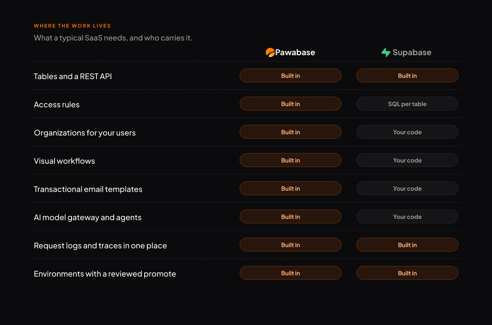
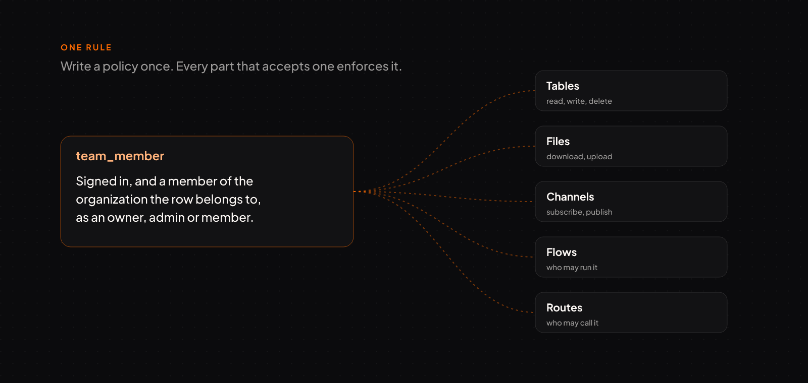
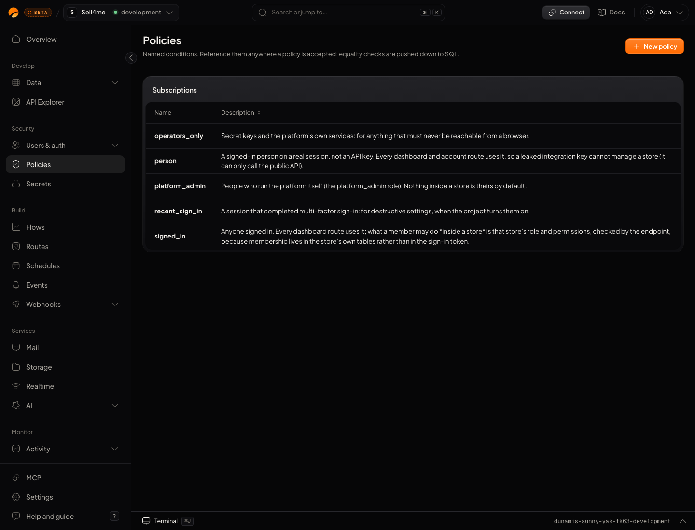
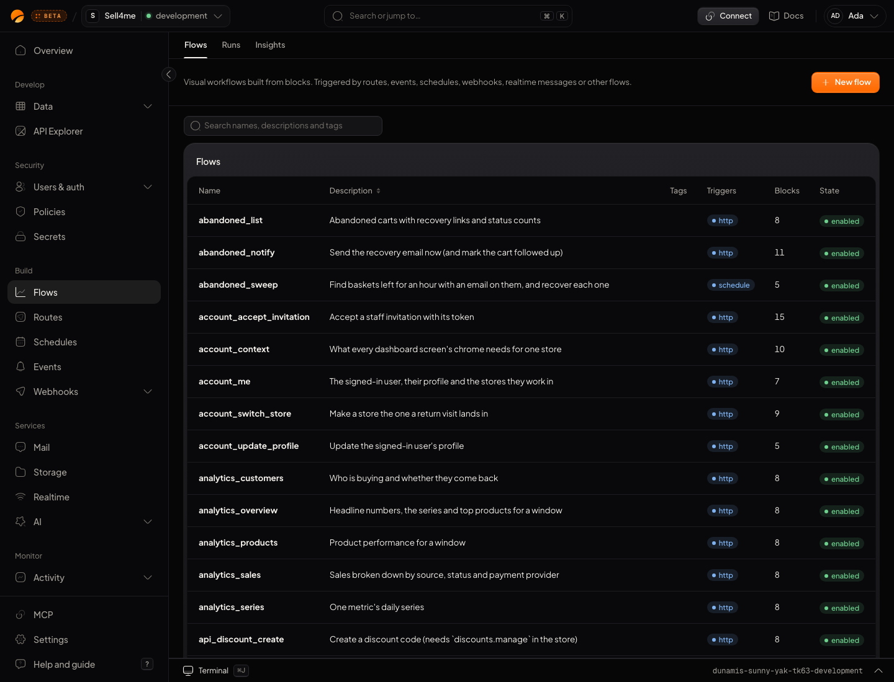

If you're choosing a backend in 2026 and you like Postgres, you've probably narrowed it down to two names. Supabase, the open-source
platform that made "Postgres with an API" mainstream. And Pawabase, the complete backend built on Postgres for products that are
meant to become businesses.

They start from the same place, and that's exactly why the comparison is interesting. Both give you a real Postgres database, an
API for every table, authentication, storage and realtime. The difference is everything that comes after: **Supabase gives you
excellent primitives and leaves the product backend for you to assemble. Pawabase gives you that product backend, already built.**

Here's what that means in practice.

## The short version

| | Pawabase | Supabase |
| --- | --- | --- |
| Database | Postgres | Postgres |
| API for every table | REST, filters, relations, search | REST and GraphQL |
| Access rules | Named policies, reused across tables, files, channels, flows, routes | Row-level security in SQL, per table |
| Organizations, roles, teams for your users | Built in | You model them |
| Enterprise SSO for your customers | Built in, per organization | Available |
| Business logic | Visual flows, plus routes, jobs and schedules | Edge functions you write in TypeScript |
| Transactional email | Template editor, sending and history built in | Bring your own provider and templates |
| AI | Gateway, agents, vector search, MCP | Vector search, AI tooling, MCP |
| Environments | Development, staging, production with a reviewed promote | Branching |
| Observability | Request traces with the flows and events they caused, alarms | Logs and reports |

Both are good platforms. The question is how much of your product's backend you want to build yourself.



## Access control: one rule, or one rule per table

This is the biggest difference between the two, and the one you'll feel every week.

In **Supabase**, access control is Postgres row-level security. It's powerful and it lives right in the database, but you write it
as SQL, table by table. Here's the classic "members of an organization may read its orders" rule:

```sql title="Supabase: one table's policy"
create policy "members can read their organization's orders"
on orders for select
using (
  exists (
    select 1 from memberships m
    where m.org_id = orders.org_id
      and m.user_id = auth.uid()
  )
);
```

Now write it again for `invoices`. And `projects`. And `comments`. Then express it for file storage, whose objects have their own
policies. Then for realtime channels. A real product has dozens of tables, and every one needs its rules written, reviewed and kept
in agreement with the rest. When the rule changes, say a new "viewer" role, you're editing SQL in many places and hoping you found
them all.

In **Pawabase**, you write that rule once as a named **policy**, in Studio or in your project's definitions, and attach it wherever
a rule is accepted: tables (with separate rules for read, write and delete), files, realtime channels, flows and routes.



Change `team_member` once and every table, bucket and channel that uses it changes with it. Pawabase pushes simple checks down into
the database query, so it never means "load everything, then filter", and Studio shows each policy in plain language, so the
person reviewing access doesn't need to read SQL.



## Organizations for your users

Almost every B2B product needs the same thing: users belong to organizations, organizations have roles and permissions, people are
invited, some customers verify their email domain so colleagues join automatically, and eventually someone pays for seats.

**Supabase** gives you excellent authentication for individual users and leaves the organization model to you. That means designing
membership tables, roles and invitations, writing RLS that understands them, building the invitation emails and flows, and
maintaining it all.

**Pawabase** has organizations built into authentication: roles and permissions, teams, invitations, verified domains, seats and
organization-level multi-factor requirements. Organization membership and role travel in the user's session, so your policies can
check them directly. When your first enterprise customer asks for single sign-on, you turn on **enterprise SSO** for their
organization, with SAML or OpenID Connect and just-in-time role assignment, instead of starting a project.

## Business logic: visual flows, or functions you deploy

Every product has logic that isn't a simple read or write. Send a welcome email and add the user to a trial. When an order is paid,
update stock, notify the warehouse and email a receipt. Every night, find abandoned carts and send a reminder.

**Supabase** handles this with edge functions, written in TypeScript and deployed separately, plus cron and queues to trigger them.
It's flexible, and it's code you write, test, deploy, monitor and keep in sync with your schema and your access rules.

**Pawabase** gives you **flows**: visual workflows built from blocks that read and write data, call APIs, send email, branch and
call AI models. A flow can be triggered by an HTTP route, a data event, a schedule, an inbound webhook, a realtime message or another
flow. It runs under the same policies as the rest of your backend, and every run is recorded with its steps, so you can see exactly
what happened and why.



The result is logic your whole team can read. Product managers can see what happens when an order is paid. Support can see why an
email didn't go out. Developers can still drop into code when they want to, through routes and the API.

## Email that's part of the product

Transactional email is one of those things that's "just an integration" until you need branded templates, variables, previews,
a history of what was sent and why something bounced.

**Supabase** sends its authentication emails (sign-up confirmations, magic links, password resets) through a default sender or
the SMTP server you configure. For everything else, receipts, notifications and invitations, you bring an email provider and build
the templates and sending logic yourself.

**Pawabase** has **Mail** built in: a visual template editor with your brand kit, variables and previews, sending from flows or the
API, sent-mail history and delivery insight. Projects that don't have a provider yet can start on Pawabase's own sender.

## AI: a gateway and agents, not just vectors

Both platforms support vector search on Postgres, and both offer an MCP server so AI coding assistants can work with your backend.

Pawabase goes further in your product itself. Its **AI gateway** gives your app one OpenAI-compatible address for every model you
connect. Your provider keys stay on the server, and your policies decide who may call which model. That's the difference between
"we added AI" and "we added AI safely". On top of it, **agents** can use your tables, flows, documents and connected apps, and stop
for a person's approval when they should. The **MCP server** gives each AI assistant a key scoped to exactly what it may touch, and
anything permanent asks first.

## Operations and visibility

**Supabase** offers branching for preview environments, logs and reports in its dashboard, and backups on its paid plans.

**Pawabase** gives every project development, staging and production **environments**, with changes moving through a reviewed
**promote**, and API versions that can run side by side so an old mobile app never breaks. Its **observability** traces every request
together with the flows, events and jobs it caused, groups errors by cause, maps where requests come from, and raises alarms when
something drifts. **Backups** are checked after they're written and restored with a safety copy taken first.

## Developer experience

Both platforms have a good dashboard and good SDKs, so this comes down to what you spend your day doing.

On **Supabase**, much of your day is in SQL and code: designing tables, writing row-level security, writing and deploying edge
functions, and connecting the services around them. Its dashboard is a capable window onto Postgres, and its client libraries are
mature.

On **Pawabase**, **Studio** is where the whole backend is built and run. Tables, policies, sign-in, organizations, flows, email
templates, AI models and agents, environments, backups and live activity all live in one place, with a command search to jump
anywhere. The **API Explorer** lets you try every endpoint with real data. The **Connect** panel writes the setup for your framework
(React, Next.js, Vue, Svelte, Angular, Astro, Flutter, iOS, Android, Node, Python and more) and your package manager, with the right
keys filled in. And the typed SDKs for TypeScript and Python feel like the API: `pawabase.from("orders").where({ status: "paid" })`.

The difference you'll feel most is how much of the system your team can see. In Pawabase, a product manager can open a flow and
understand what happens when an order is paid, and support can find a customer and see their recent activity, all under the same
rules that protect your API.

## Realtime and storage

Both platforms do realtime and file storage well, with different emphases.

**Realtime.** Supabase offers broadcast, presence and database change streams. Pawabase offers channels with presence, durable
message history so a client that reconnects catches up, and **live queries** that re-run a list and push the new result when its
data changes. Its channel rules use the same policies as everything else, so "members of this organization may subscribe" is the
same `team_member` rule you already wrote. Studio shows every channel, who is subscribed and what was sent.

**Storage.** Both give you buckets, access rules and image transformations. Pawabase adds per-action rules (upload, download, list
and delete can each have their own policy), share links that expire on their own, and profile pictures for your users handled for
you.

## Pricing approach

We won't quote Supabase's prices here, because they change; check their pricing page for the current numbers. What we can describe
is the approach.

Pawabase prices by what you use: projects, database size, users and traffic. There's a free plan for prototypes, every feature free
for seven days for new organizations, and paid plans from there. The features that cost Pawabase real money to provide, like
backups, data export and full request details, start on Starter, and team, AI and enterprise features on higher plans. You never
need a second vendor to fill a gap, which is where most backend bills actually grow.

## Where Supabase is the better fit

We'll be straight about it. Supabase is a great choice if:

- you want to **self-host** an open-source platform today;
- your team enjoys writing **SQL and row-level security** and wants to stay as close to raw Postgres as possible;
- you need **GraphQL** out of the box;
- your app is mostly CRUD and you don't expect to need organizations, workflows, email or an AI gateway.

## Where Pawabase wins

Pawabase is the better fit when you're building a **product meant to become a business**:

- a **SaaS or B2B app** that needs organizations, roles, invitations and, eventually, enterprise SSO;
- a product with real **business logic** that you want visible and maintainable, not scattered across functions;
- a team that wants **one access model** for data, files, channels and logic;
- anyone adding **AI** who wants keys on the server and rules on every call;
- teams that want **environments, tracing and backups** handled from day one.

In short: if you'd rather spend the next six months on your product than on its backend, Pawabase is the one to build on.

## Frequently asked questions

### Is Pawabase a Supabase alternative?

Yes. Both are Postgres-based backend platforms with an API for every table, auth, storage and realtime. Pawabase adds what you
would otherwise build on top of Supabase: shared access policies, organizations for your users, visual flows, transactional email,
an AI gateway and agents.

### Which is easier to secure?

Pawabase. With row-level security you write and review SQL policies table by table, and again for storage and realtime. With
Pawabase you write named policies once and attach them everywhere, and Studio shows each one in plain language.

### Which is better for B2B SaaS?

Pawabase, because organizations, roles, invitations, verified domains, seats and enterprise SSO for your customers are built in.
On Supabase, that model is yours to design and maintain.

### Can I use both?

You can, but you'd be running two sets of users and rules, which is the problem Pawabase exists to remove. Most teams pick one
system for the product backend.

## Moving from Supabase to Pawabase

Because both run on Postgres, a move is a translation, not a rewrite. Here's the path we recommend.

<Steps>

### Bring your schema and data

Create a Pawabase project and recreate your tables, or import your data. Each table gets an API immediately, and your column
types, relations and constraints carry over because it's Postgres on both sides.

### Turn row-level security into policies

List your RLS policies and group them by what they *mean*: "the row's owner", "a member of the row's organization", "an admin". Each
group becomes one named policy in Pawabase, attached to every table, bucket and channel that used it. Most teams end up with a
handful of policies where they had dozens of SQL statements.

### Move sign-in and organizations

Turn on the same sign-in methods in Pawabase. If you modelled organizations yourself, map your membership tables onto Pawabase
organizations, roles and teams, and retire the custom tables, invitation code and emails you maintained.

### Rebuild edge functions as flows

Most edge functions are glue: when this happens, do that, then send an email. Rebuild each as a flow with the same trigger, and keep
anything genuinely custom as a route. Every run is now recorded with its steps, which makes the first week after a migration much
calmer.

### Point your app at Pawabase

Swap the client for `@pawabase/client`, use Connect to generate the setup for your framework, and test against your development
environment. When everything passes, promote to production.

</Steps>

What you gain is everything you'd otherwise have kept building yourself: one access model, organizations, flows, email, an AI
gateway, environments and tracing.

<Callout type="tip" title="Try the whole system for seven days">
  Every new Pawabase organization starts with **every feature, free for seven days**, at the highest limits. Bring a slice of your
  Supabase schema, recreate one access rule as a policy and one edge function as a flow, and see the difference for yourself.
</Callout>

[Start free on Pawabase](https://dashboard.pawabase.com/signup), or see how Pawabase ranks against eight more platforms in
[the 10 best backend platforms of 2026](/blog/best-backend-as-a-service-platforms-2026).
