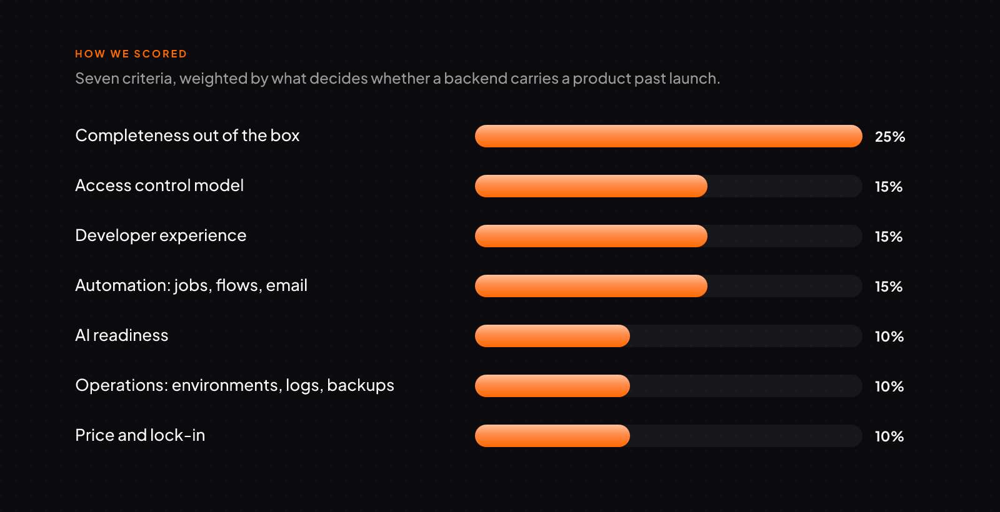
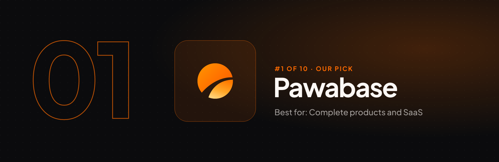
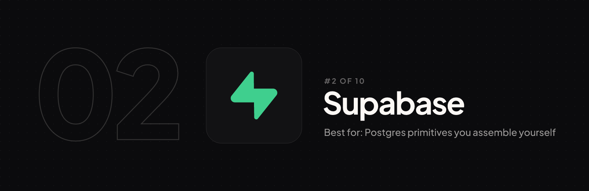
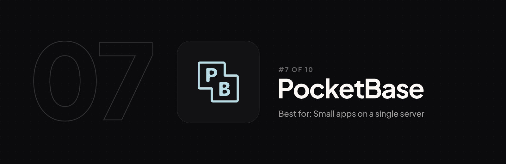

Choosing a backend platform used to be a question of which database you liked. In 2026 it's one of the biggest decisions a
product team makes. The platform you pick decides how you handle sign-in and organizations, where your business logic lives, how
you call AI models without leaking keys, how you see what's happening in production, and how much glue code your team will maintain
for the next five years.

The market has never been more crowded. There are open-source platforms you run yourself, managed services from the cloud giants,
reactive databases, single-binary backends and no-code API builders. Each one is excellent at something. Very few are excellent at
the thing that matters most once a product is real: carrying the whole backend, not just the database.

We looked at the ten platforms teams ask us about most and ranked them on what actually decides whether a backend carries a product
past launch. Yes, we make one of them, and we'll be upfront about that. We'll also be upfront about where each of the others
shines, because the right choice depends on what you're building.

## How we scored them

A backend that's delightful for a demo and painful at a hundred customers isn't a good backend. So we weighted seven criteria by
how much they matter once a product is real:

- **Completeness out of the box (25%).** How much of a real product's backend is there without adding other services: data, an
  API, auth, organizations for your customers, storage, realtime, jobs, email and workflows. Every gap is a vendor to add and glue
  to maintain.
- **Access control model (15%).** How you express who may do what, and whether one rule can protect data, files, channels and logic
  alike. Most security incidents in young products are access rules that disagree with each other.
- **Developer experience (15%).** SDKs, docs, a dashboard you actually want to open, and a smooth path from local work to production.
- **Automation (15%).** Background jobs, schedules, webhooks, transactional email and business workflows: the logic that makes a
  product feel alive.
- **AI readiness (10%).** Calling models without exposing keys, rules on who may call which model, agents, search by meaning, and
  tooling for AI coding assistants.
- **Operations (10%).** Environments, safe releases, logs and traces, backups and restores you've actually tested.
- **Price and lock-in (10%).** Predictable pricing as you grow, and how hard it would be to leave.

We judged each platform, from its documented features, against the same brief: a multi-tenant SaaS with organizations, roles,
file uploads, a live-updating board, a few transactional emails, a nightly job and an AI-powered summary. The question for each was
simple: *how much of that does the platform carry, and how much do you build?*

## The ranking at a glance

| Rank | Platform | Data model | Best for |
| --- | --- | --- | --- |
| 1 | **Pawabase** | Postgres | Complete products and SaaS, from first table to enterprise customers |
| 2 | Supabase | Postgres | Teams who want Postgres primitives and are happy to assemble the rest |
| 3 | Firebase | Documents | Mobile apps deep in Google's ecosystem |
| 4 | Convex | Reactive documents | Reactive TypeScript apps where everything is a function |
| 5 | Appwrite | Documents | Teams who want an open-source platform to self-host |
| 6 | AWS Amplify | Mixed AWS services | Teams standardised on AWS |
| 7 | PocketBase | SQLite | Small apps and prototypes on a single server |
| 8 | Nhost | Postgres + GraphQL | GraphQL-first teams |
| 9 | Xano | Postgres-backed, visual | No-code and low-code builders |
| 10 | Back4App | Parse Server | Teams with existing Parse apps |

Now the details.

## 1. Pawabase

**Best for:** any product that's meant to become a business, from a solo developer's first app to a B2B SaaS selling to
enterprises.

Pawabase is the only platform on this list that treats the backend as **one system** rather than a collection of services. Every
part (the data API, authentication, access policies, storage, realtime, visual flows, background jobs, email, the AI gateway and
agents, observability and backups) shares one Postgres database, one set of users and one set of rules. That single design decision
is why it wins almost every category in our rubric.

On **completeness**, nothing else comes close. Organizations for your customers, with roles, permissions, teams, invitations,
verified domains and seats, are built into authentication, not a weekend of custom tables. Transactional email has a visual template
editor, variables and sent-mail history. Business logic lives in visual **flows** that anyone on the team can read, triggered by
HTTP routes, data events, schedules, inbound webhooks or realtime messages. Every item in our SaaS brief is covered without adding another service.

On **access control**, Pawabase's named **policies** are the standout feature of the year. You write a rule like "a member of this
organization" once and attach it to tables, files, realtime channels, flows and routes. Every other platform here makes you express
the same rule separately for each kind of resource, often in a different language for each. Pawabase also pushes simple checks
down into the database query, so security never costs you a full table scan.

On **AI readiness**, Pawabase ships an OpenAI-compatible **AI gateway** that keeps provider keys on the server and applies your
access rules to every model call, **agents** that use your data and tools and ask for approval when they should, **vector search**
on any table, and an **MCP server** that gives each AI coding assistant a key scoped to exactly what it may touch.

On **operations**, every project gets development, staging and production environments, a reviewed **promote** between them, API
versions that run side by side, request tracing that shows the flows and events each request caused, alarms, and **backups** that
are verified after they're written.

**Standout features**
- One access model for tables, files, channels, flows and routes
- Organizations, roles, teams, invitations and enterprise SSO for your customers, built in
- Visual flows, queues, schedules and signed webhooks
- Transactional email with a template editor and history
- AI gateway, agents, vector search and an MCP server
- Environments, promote, tracing, alarms and verified backups

**Trade-offs:** Pawabase is newer than the household names on this list, so its community is still growing. The flip side is that
you need far fewer community packages, because the parts are already there.

**Pick it if** you're building a product people will pay for, especially one that will sell to teams and companies, and you'd
rather spend your time on the product than on its backend. Every new organization gets every feature free for seven days.

## 2. Supabase

**Best for:** developers who love Postgres and want a strong set of primitives to build on.

Supabase deserves its popularity. It gives you a hosted Postgres database with an auto-generated REST and GraphQL API,
authentication with many providers, file storage, realtime, edge functions written in TypeScript, vector support, cron and queues,
database branching, a capable dashboard, and the option to self-host. Its community and ecosystem are among the largest of any
platform here, and its documentation is excellent.

Where it trails Pawabase against our brief is in what you assemble yourself. Access control is written as Postgres row-level security,
in SQL, table by table, and again for storage and realtime. Organizations, roles and invitations for your customers are up to you
to model. Business workflows mean writing and deploying edge functions, and transactional email beyond sign-in messages means
wiring in a separate provider. None of that is hard for a strong Postgres team, but all of it is work that Pawabase has already done.

**Standout features**
- Real Postgres with row-level security
- REST and GraphQL APIs, realtime and storage
- Edge functions, cron, queues and vectors
- Open source and self-hostable, with a big community

**Trade-offs:** more of the product backend is yours to build: access rules in SQL per table, organizations, workflows, email.

**Pick it if** your team enjoys SQL, wants to stay close to raw Postgres, or needs to self-host today. For a deeper look, read
[Pawabase vs Supabase](/blog/pawabase-vs-supabase).

## 3. Firebase

**Best for:** mobile apps that also want Google's analytics, messaging and crash reporting.

Firebase remains a powerhouse for mobile. Firestore's realtime sync, offline support and polished client SDKs are excellent, and
the surrounding products (push messaging, remote config, crash reporting, analytics, hosting) are hard to beat if you live in
Google's ecosystem. Data Connect has also brought a Postgres option into the family for teams that need relational data.

The trade-offs are well known. Firestore is a document database, so relational data, joins and reporting take careful design and
often duplication. Its security rules are a language of their own. Costs that follow document reads and writes can surprise a
growing app, and moving off Google Cloud later is a real project.

**Standout features**
- Realtime sync and offline support on mobile
- Push messaging, remote config, analytics and crash reporting
- Massive scale on Google's infrastructure

**Trade-offs:** a document data model for most of the platform; costs that can be hard to predict; deep lock-in.

**Pick it if** you're building a mobile-first consumer app and want Google's mobile toolkit around your backend.

## 4. Convex

**Best for:** TypeScript teams building highly reactive, collaborative apps.

Convex rethinks the backend as TypeScript functions on top of a reactive database. Queries keep the UI up to date automatically
when data changes, mutations are transactional, and scheduled functions and file storage are built in. For collaborative,
live-updating apps it's a genuinely joyful developer experience, and its type safety from database to UI is first class.

Its strength is also its constraint: everything is code. Access rules, workflows and integrations are functions you write and
maintain, and the data model is Convex's own rather than standard SQL, which matters for reporting and portability.

**Standout features**
- Reactivity by default, end to end
- Transactional TypeScript functions with strong typing
- Scheduled functions and file storage

**Trade-offs:** logic and rules all live in code; a non-SQL data model; less for the non-developers on your team.

**Pick it if** your product is fundamentally a live, collaborative interface and your team is all-in on TypeScript.

## 5. Appwrite

**Best for:** teams that want an open-source backend they can run themselves.

Appwrite offers databases, authentication, storage, functions in many languages, messaging (email, SMS and push), realtime and
hosting, and it's designed to be self-hosted as comfortably as it's used in the cloud. Its console is polished and its community
is active and welcoming.

Its database API is document-style rather than raw SQL, which keeps simple apps simple but makes relational modelling and reporting
harder. More advanced product needs, such as shared access patterns, business workflows and AI, are left to your functions.

**Standout features**
- Open source and self-hostable
- A broad feature set, including messaging
- Functions in many runtimes

**Trade-offs:** a document-style data API; workflows and AI are your code.

**Pick it if** running your backend on your own infrastructure is a hard requirement.

## 6. AWS Amplify

**Best for:** teams already standardised on AWS.

Amplify wraps AWS services (Cognito for auth, AppSync for a GraphQL API, DynamoDB for data, S3 for files and Lambda for logic)
behind a TypeScript-first developer experience. If your company runs on AWS, it keeps everything inside the same account,
compliance boundary and bill, and gives you the full depth of AWS when you need it.

The cost is complexity. Your backend is many AWS services working together, and when something goes wrong you're debugging the
underlying services, their permissions and their limits. For a small team, the learning curve is steep.

**Standout features**
- The full power, scale and compliance story of AWS
- TypeScript-first backend definitions

**Trade-offs:** complexity; many moving AWS parts to understand; AWS lock-in.

**Pick it if** your organization has already chosen AWS for everything and has the people to run it.

## 7. PocketBase

**Best for:** small apps, internal tools and prototypes.

PocketBase is a single executable that gives you a SQLite database, authentication, file storage, realtime subscriptions and an
admin dashboard. It's remarkably capable for its size, starts in seconds, and extending it with Go or JavaScript hooks is
straightforward. For a side project or an internal tool, it's hard to beat on simplicity.

It's designed to run on a single server, so scaling out, high availability, team-scale operations and backups are yours to handle.

**Standout features**
- One file to deploy; fast and lightweight
- Auth, files, realtime and an admin UI included
- Open source and easy to extend

**Trade-offs:** single-node by design; operations and growth are yours to manage.

**Pick it if** you want the simplest possible backend for something small and don't expect it to grow into a business.

## 8. Nhost

**Best for:** GraphQL-first teams who want Postgres.

Nhost combines Postgres with Hasura's GraphQL engine, plus authentication, storage and serverless functions. If your front end
speaks GraphQL, it's a natural fit: your schema becomes a GraphQL API instantly, and Hasura's permission system is expressive.

Teams that don't want GraphQL get less from it, and like most platforms here, business workflows, transactional email and AI are
left to your functions.

**Standout features**
- Instant GraphQL on Postgres
- Hasura's permission system
- Open source

**Trade-offs:** GraphQL-centric; workflows, email and AI are your code.

**Pick it if** GraphQL is your team's default and you want it on Postgres with minimal setup.

## 9. Xano

**Best for:** no-code and low-code builders who need a real backend.

Xano gives you a database and a visual API builder, so people who don't write backend code can still create endpoints with real
logic, authentication and integrations. It pairs well with no-code front-end tools and has helped a lot of non-developers ship
real products.

Developers who prefer code-first workflows, typed SDKs and standard tooling may find it limiting, and its visual builder is focused
on APIs rather than the full set of product backend needs.

**Standout features**
- Visual API building
- Approachable for non-developers

**Trade-offs:** less suited to code-first teams; a narrower backend scope.

**Pick it if** your team builds with no-code tools and needs a backend to match. If you want visual logic *and* code-first tools in
one place, Pawabase's flows give you both.

## 10. Back4App

**Best for:** teams running apps built on Parse Server.

Back4App hosts the open-source Parse Server, with REST and GraphQL APIs, cloud code and a dashboard. For teams with existing Parse
apps, it's a well-trodden path that keeps them running without managing servers.

For new projects, the Parse model shows its age next to the platforms above, particularly around modern auth, access control and
AI.

**Standout features**
- Managed Parse Server
- A mature API surface

**Trade-offs:** an older platform model; fewer modern features for new products.

**Pick it if** you already have a Parse app and want it hosted.

## The patterns behind the ranking

Looking across all ten, three patterns decided most of the ranking.

**Primitives aren't products.** Most platforms here give you excellent building blocks (a database, an API, auth, functions) and
leave the product backend to you. The gap between "we have auth" and "our customers have organizations, roles, invitations and
SSO" is months of work. Platforms that close that gap win.

**Rules that live in one place are rules that stay correct.** When access rules are written separately for tables, files,
realtime and logic, they drift apart, and drifting rules are how data leaks. A single access model across every part is the most
underrated feature in this category.

**AI raised the stakes.** Two years ago, a backend didn't need to know about models. Today almost every product calls one, and the
backend is where keys must live, where rules must apply, and where agents get their tools. Platforms that treat AI as a first-class
part of the backend are pulling ahead.

## Frequently asked questions

### What is a backend-as-a-service?

A backend-as-a-service (BaaS) gives you the server side of an app (a database, an API, authentication, file storage and usually
realtime) as a managed service, so you don't build and run those parts yourself. The best platforms in 2026 go further, with access
control, background jobs, workflows, email and AI.

### Which BaaS is best for a SaaS product?

For a SaaS, the deciding features are organizations and roles for your customers, one access model for every part of the backend,
business workflows and enterprise SSO. Pawabase is the only platform on this list with all of them built in, which is why it ranks
first for SaaS.

### Which BaaS is best for AI apps?

Look for three things: a way to call models without shipping provider keys to the browser, rules on who may call which model, and
search by meaning over your own data. Pawabase covers all three with its AI gateway, policies and vector fields, and adds agents and
an MCP server on top.

### Is Postgres better than a document database for a BaaS?

For most products, yes. Relational data, reporting, joins and constraints come naturally in Postgres, and it keeps your data
portable. Pawabase, Supabase and Nhost are Postgres-based; Firebase and Appwrite use document-style data models for most of their
platforms.

### Can I switch backends later?

You can, but it gets more expensive every month, because your access rules, logic and integrations are written against the platform
you chose. That's the strongest argument for choosing a complete system early.

## How to choose

If you remember one thing from this ranking, make it this: **the cost of a backend isn't the first month, it's the glue you write
for the next sixty.** Every service you add is another set of users to sync, another rule to keep in agreement, another bill and
another dashboard during an incident.

- Building a **real product or SaaS**, especially one that will sell to teams and companies? **Pawabase** gives you the whole
  system, including organizations, enterprise SSO, workflows and AI, without the assembly.
- Want **Postgres primitives** and enjoy building the rest yourself? Supabase is a strong choice.
- Building a **mobile app** deep in Google's ecosystem? Firebase.
- Building something **highly reactive in TypeScript**? Convex.
- Need to **self-host open source**? Appwrite or PocketBase, depending on scale.
- Standardised on **AWS**? Amplify.

<Callout type="tip" title="See for yourself">
  Every new Pawabase organization gets **seven days of every feature** at the highest limits. Build the hardest part of your
  product on it, organizations, access rules and a flow or two, and compare that to what it takes anywhere else.
</Callout>

[Start free on Pawabase](https://dashboard.pawabase.com/signup), or read our deeper comparison of
[Pawabase and Supabase](/blog/pawabase-vs-supabase).
