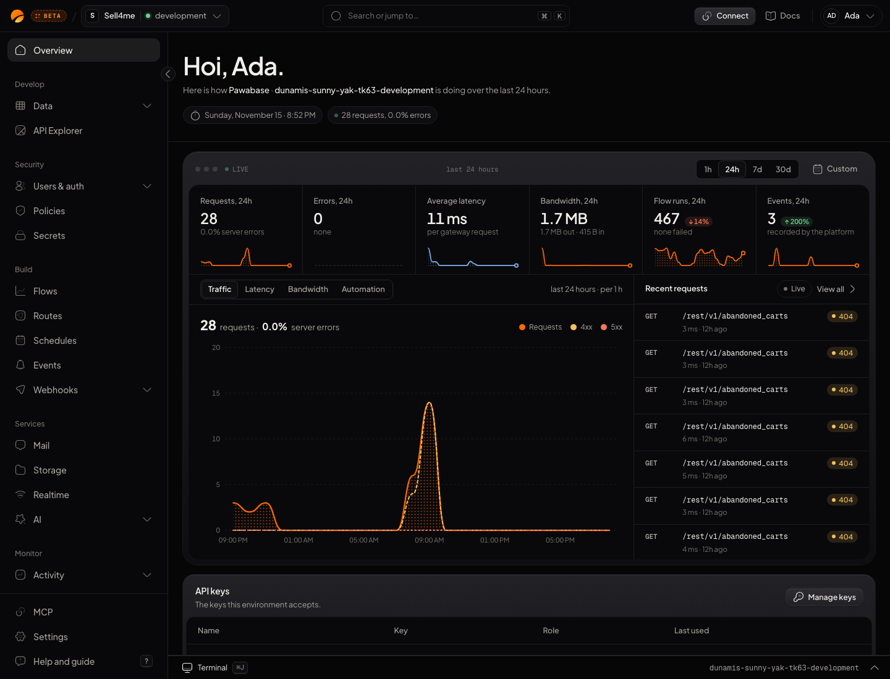
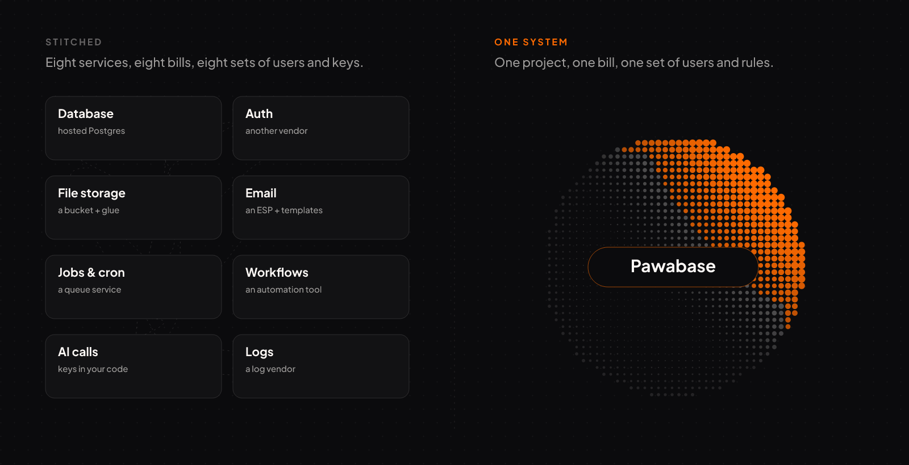
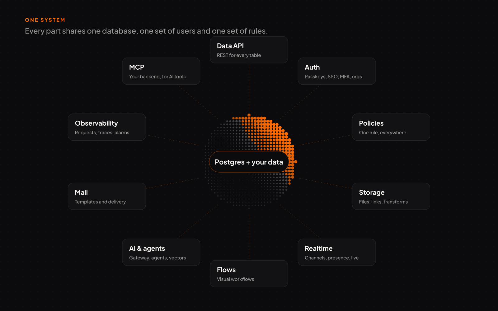
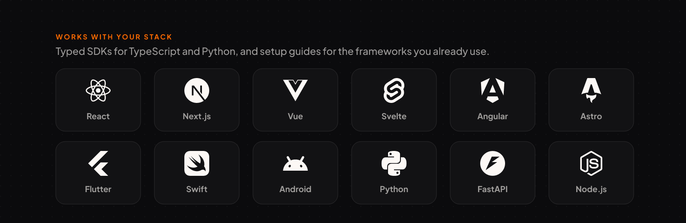
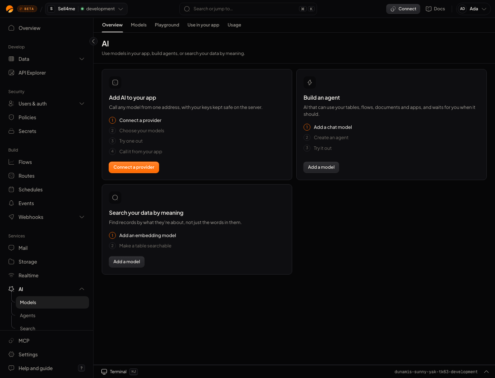

Every product ends up needing the same backend. A database. An API in front of it. Sign-in, and then organizations, roles and
invitations the week after. Somewhere to put files. Background jobs. Email that doesn't look like it came from 2009. Rules for who
may see what. Logs for when it breaks at 2am. And now, AI: models, keys, agents, and a way to keep all of it from leaking.

None of that is the product you set out to build. It's the tax you pay before you get to build it.

Today we're launching **Pawabase**: the complete backend for anything you build. One system that gives you all of those parts,
already working together, from the first table of a weekend project to the backend a company runs its business on.



## The problem with assembling a backend

The usual way to build a backend in 2026 is to assemble one. A database from one vendor. Authentication from another. Storage from a
third. A queue service for background work, an email provider plus a template tool, an automation product for the workflows, an AI
provider whose keys end up in three different codebases, and a log vendor to tell you which of the other seven is broken.

Each one is good at its job. Together they're a liability:

- **Eight sets of users and keys.** Your users live in the auth provider, but your files, jobs and workflows each have their own idea
  of who's allowed to do what. Keeping them in agreement is a project of its own.
- **Eight bills and eight dashboards.** Cost becomes impossible to predict, and an incident becomes a tour of tabs.
- **Glue code that nobody owns.** Webhooks between services, retries around flaky calls, a cron job that syncs two things that should
  never have been separate.
- **Rules written five times.** "Members of this organization may read its orders" ends up encoded in your API, your storage policy,
  your realtime channel and your workflow tool, each in its own language. One of them is always wrong.



We built Pawabase because we were tired of paying that tax, and we think you are too.

## What Pawabase is

Pawabase is one backend system built on Postgres. Every part of it shares the same database, the same users and the same rules.
You design it visually in **Pawabase Studio**, call it from any app through a clean API and typed SDKs, and run it on **Pawabase
Cloud** with environments, backups and full visibility built in.



Here's what you get, on day one, in every project.

### Data and APIs

Create tables in Studio and you have an API before you've written a line of backend code. Every table gets a REST endpoint with
filtering, relations, full-text search and pagination, documented in an API explorer you can try right in the browser. Your schema
changes are migrations with a history you can read, and roll back when you need to.

```ts title="src/orders.ts"
import { pawabase } from "./pawabase";

// open orders for this store, newest first, with their customer attached
const { data: orders } = await pawabase
  .from("orders")
  .where({ status: "open" })
  .expand("customer")
  .perPage(20);
```

Pawabase works with whatever you build your front end in. Typed SDKs for TypeScript and Python, and setup guides (with your keys
already filled in) for the frameworks you already use:



### Authentication that grows with you

Email and password, passkeys, social and custom sign-in providers, multi-factor authentication, sessions and devices you can see and
revoke. Then the part every B2B product needs and nobody wants to build: **organizations** for your users, with roles, permissions,
teams, verified domains, seats and invitations. When an enterprise customer asks for single sign-on, you turn on **enterprise SSO**
(SAML or OpenID Connect) for their organization, with just-in-time provisioning. You don't spend a quarter building it.

Services and AI agents get identities of their own too: **machine identities** with their own keys and access, so an integration
never has to borrow a person's account.

### Access policies: one rule, everywhere

This is the part we're proudest of. In Pawabase you write an access rule once, as a named **policy**, and use it everywhere a rule
is accepted: tables, files, realtime channels, flows and routes. "A member of this organization" is defined in one place and
enforced in every one of them. Change it once and every part changes with it. Where it can, Pawabase pushes the check down into the
database query itself, so a rule never means "fetch everything, then filter".

### Storage, realtime and email

**Storage** gives every project buckets with per-action rules (who may upload, download, list or delete), share links that expire
on their own, and image resizing on the fly. **Realtime** gives you channels with presence, durable message history and live
queries that update a list the moment its data changes. **Mail** gives you a visual template editor, variables, sent-mail history
and delivery insight, so a password reset or an invoice email looks like your brand, not like a default.

### Flows and background work

**Flows** are visual workflows, built from blocks: read and write data, call an API, send email, branch on a condition, call a model.
A flow can be triggered by an HTTP route, an event in your data, a schedule, an inbound webhook, a realtime message or another
flow. Under them sit durable **queues** with retries, **schedules** with cron or intervals, and signed **webhooks** in and out.
The logic that usually ends up scattered across serverless functions and automation tools lives in one place you can read.

### AI built in, not bolted on

Pawabase includes an **AI gateway**: one OpenAI-compatible address for every model you connect, with your provider keys kept on the
server and your access rules deciding who may call which model. On top of it, **agents** that can use your tables, flows,
documents and connected apps, and wait for a person's approval when they should. Any table can be made searchable **by meaning**
with vector fields, so "find tickets like this one" is a single call.



And because your backend should be as easy for an AI coding assistant to work with as it is for you, every environment comes with
an **MCP server**. Connect Claude, Cursor or any MCP client with a key scoped to exactly what it may touch. It can read your schema
and build tables and flows with you, and anything permanent asks first.

### Operations, handled

Every project has **environments**: development, staging, production. Changes move between them through a reviewed **promote**, and
API versions can run side by side so you never break a mobile app that hasn't updated yet. **Observability** is built in: every
request with its trace, the flows and events it caused, errors grouped by cause, latency and bandwidth, a map of where requests
come from, and alarms when something drifts. **Backups** are taken on your schedule, checked after they're written, and restorable
in a click, with a safety copy taken before any restore.

## How we built it: four principles

Every decision in Pawabase comes back to four principles. They're also the best way to judge whether it's right for you.

**1. One system, not a set of services.** Every part shares one database, one set of users and one set of rules. When a part needs
to know who someone is, it asks the same place. When a rule changes, it changes everywhere. This is the difference between a backend
and a pile of integrations.

**2. Complete, then composable.** The parts work together from day one, so a new project already has sign-in, organizations, email
and jobs. But nothing is a black box: every part is reachable through the API and the SDKs, and you can drop into code wherever you
want more control.

**3. Make it visible.** Clear states and useful errors beat magic that disappears when something breaks. Every request is traced,
every flow run is recorded step by step, every email has a history, and every backup is checked. When something goes wrong at 2am,
the answer is a click away, not a hunch.

**4. Built for small teams with big ambitions.** A team of three should be able to ship software that would normally take a platform
team to run. Pawabase handles the operational work (environments, promotes, backups, alarms) so a small team can sell to large
customers without becoming an infrastructure department.

## Who Pawabase is for

**Solo developers and indie hackers.** Ship a real product on a weekend without stitching services together. The free plan carries
a prototype, and when it takes off, the same system scales with it.

**Startups.** Get to market with the backend you'd otherwise spend your first quarter building: organizations, roles, email,
background jobs and AI, ready from the first commit. When your first enterprise customer asks for single sign-on, say yes.

**Agencies and studios.** Build client products on one system you know inside out, with a project per client, environments for
review, and a Studio clients can actually use.

**Product teams at growing companies.** Replace the tangle of services behind your internal tools and products with one backend
your whole team can see and safely work from.

## Built for teams, not just for code

A backend isn't only for the developer who builds it. Support needs to look up a customer. Operations needs to see what a job did.
A founder wants to know why signups dropped yesterday. In most stacks, each of those means a ticket to an engineer.

Pawabase is built so the people around a product can work from it safely. Studio gives each of them a clear view of the data and
the activity they need, and the same policies that protect your API decide what they can see and change. Your backend becomes
the shared system a team works from, not a black box only one person understands.

## Start free, with every feature for seven days

Pawabase Cloud has a free plan for prototypes, experiments and learning the platform, and paid plans priced by what you use:
projects, database size, users and traffic. Not by which features you're allowed to have.

<Callout type="tip" title="Try everything first">
  Every new organization starts with **seven days of every Pawabase feature**, at the highest limits, with no card needed. Build
  something real on the whole system before you decide anything.
</Callout>

Then pick the plan that fits. Starter adds backups, data export and full request details; Pro adds the AI gateway, organizations,
machine identities and bot protection; Business adds enterprise SSO. Your data and projects stay yours on every plan.

## Questions people ask us

### Is Pawabase a backend-as-a-service?

It does everything a backend-as-a-service does (database, API, auth, storage, realtime) and keeps going: organizations for your
users, access policies shared across every part, visual workflows, transactional email, an AI gateway and agents, environments,
tracing and backups. We think of it as the complete backend, the system your product and your team both work from.

### Do I have to use the visual tools?

No. Everything you build in Studio is also available through the API and the SDKs, and your app talks to Pawabase through clean
REST endpoints and typed clients for TypeScript and Python, with setup guides for React, Next.js, Vue, Svelte, Angular, Flutter,
iOS, Android and more. Use Studio where it's faster, code where you prefer it.

### Is my data locked in?

Your data lives in Postgres, the most widely used open database there is. Paid plans include data export and backups you can
download, so your data is never trapped.

### What does it cost?

There's a free plan for getting started, every feature free for seven days for new organizations, and paid plans priced by what
you use. See [pricing](/pricing) for the details.

## What's next

We're going to keep doing what we've done so far: make each part deeper while keeping the whole simple. Expect more flow blocks,
more AI connectors, richer insights, and more of the boring operational details handled before you have to think about them.

If you've ever spent a sprint wiring services together instead of shipping your product, Pawabase is for you.

[Start building for free](https://dashboard.pawabase.com/signup), read [the docs](https://docs.pawabase.com), or come back to this
blog. We'll be writing about what we ship and how it works.
