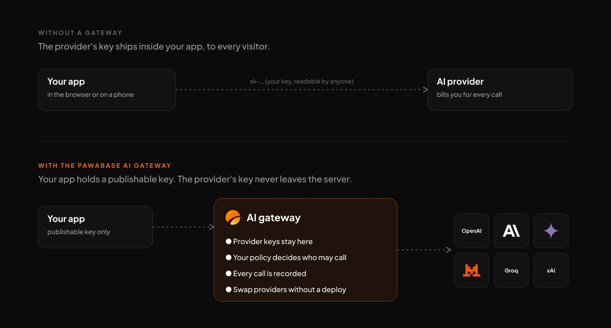
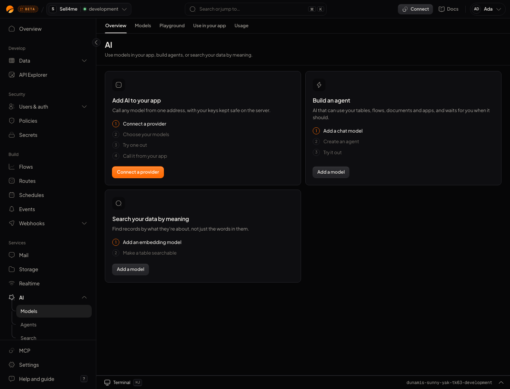

Every week, someone finds an AI provider's secret key in a public app. It's in the JavaScript bundle of a weekend project, in the
build of a mobile app, in a repository that was public for one afternoon. Scrapers look for these keys all day, and the first sign
that one was found is usually the bill.

Nobody ships a key on purpose. It happens because calling a model straight from your app is the fastest way to build an AI feature,
and the fastest way puts the key where the code runs. The safe way, a server in between, has always meant building, securing and
running one more thing, usually on a deadline.

Today we're making the safe way the fast way. Every Pawabase environment now includes an **AI gateway**: one address for every model
you connect. The provider keys stay on the server, your access rules decide who may call each model, and every call is recorded with
who made it and what it cost.



In this post we'll show what the gateway is, then build a real feature with it: an AI-powered support inbox that summarises tickets,
drafts replies, finds similar past tickets and hands the hard ones to an agent, without one provider key on a user's device.

## The proxy everyone ends up writing

Ask any team that has shipped an AI feature to real users, and they'll describe the same piece of code. It starts as a small server
endpoint that holds the key and forwards a prompt. Then it grows:

- **Authentication**, because the endpoint is on the internet, and anyone who finds it can spend your money.
- **Rules**, because free users should get the small model and only admins should get the expensive one.
- **Rate limits and logging**, because one user with a loop can cost more than the rest of your customers combined, and you need to
  know who it was.
- **Streaming**, because nobody wants to stare at a spinner for twelve seconds while a model writes a paragraph.
- **A wrapper for each provider**, because each API is slightly different, and switching from one to another means a rewrite.
- **Retries and fallbacks**, because every provider has bad days, and "the AI is down" is a support ticket you can't fix.

That's a week of work with nothing to do with your product, followed by years of maintenance. It's also the code where a mistake
costs real money. The AI gateway is that whole proxy, built into the backend your app already uses.

## Meet the AI gateway

### Connect a provider once

In Studio, open **AI** and connect a provider: **OpenAI, Anthropic, Google Gemini, Mistral, Groq, xAI**, or any service that speaks
the OpenAI API, including models you host yourself. You paste the provider's key once. It's stored on the server, and from then on it
never travels to a browser, a phone or a log.

You keep your own account with each provider, so you pay them directly at their prices. Pawabase never marks up your tokens.

### Expose models under your own names

Next, choose the models your app may use and give each one a name of your own: `chat` for your everyday assistant, `fast` for quick
classifications, `embed` for search. Your app calls the name, never the vendor's model ID.

This is the change that pays off for years. When a better or cheaper model comes out next month, you point `chat` at it in Studio and
every app you've shipped uses it on the next request. **No code change, no deploy, no app-store review.** You can move a name from one
provider to another the same way, because the gateway speaks one format to your app and translates for each provider behind it.

Each name can also carry:

- **Instructions**: a system prompt kept on the server. Your product's voice and rules live in one place instead of being copied into
  every client, and anyone reading your bundle can't see them. When an app sends its own system message, that one is used instead.
- **A fallback** ("If it fails, try"): another model to call when this one is rate limited, times out or has an outage. If `chat`
  is on one provider and its fallback is on another, a provider's bad afternoon never reaches your users.
- **Prices**: the model's input and output prices, so Studio can show you what every call cost.

### Decide who may call each model

Every model has a **policy**: who may use it. These are the same access rules that already protect your tables and files, so there's
nothing new to learn and nothing to keep in sync.

By default, a new model can be called **only from your servers**. You open it up on purpose: to signed-in users, to members of an
organization, to admins only, or to any rule you've written. The cheap `fast` model can be open to everyone signed in, while the large
`reasoning` model is limited to your paid plan.

When someone isn't allowed, the gateway refuses before your provider is ever called. A signed-out visitor who tries a model that needs
sign-in gets a clear `401` with "sign in to use this model". A signed-in user without access gets a `403`. Either way, your provider
never sees the request, and you're never billed for it.

### Call it from your app

Your app talks to the gateway with its ordinary **publishable key**, the same one it already uses for data and sign-in. That key is
safe to ship, because what it can do is decided by your rules, not by the key. The person's sign-in session tells the gateway who is
asking.

```ts title="src/pawabase.ts"
import { createClient } from "@pawabase/client";

export const pawabase = createClient({
  url: import.meta.env.VITE_PAWABASE_URL,
  project: import.meta.env.VITE_PAWABASE_PROJECT,
  apiKey: import.meta.env.VITE_PAWABASE_KEY, // a publishable key: safe to ship
});
```

That's the whole setup. Now let's build something with it.

## Build it: an AI support inbox

Imagine a helpdesk app with a `tickets` table. Agents (the human kind) read tickets, reply to customers and close them. We'll add four
things, each in a few lines of code:

<Steps>

### Summarise a ticket

Long, angry, three-screen tickets are where support time goes. `ai.chat` takes a model name and a prompt and returns the answer as
text:

```ts title="src/inbox/summary.ts"
export async function summarise(ticket: { subject: string; body: string }) {
  return pawabase.ai.chat("fast", [
    { role: "system", content: "Summarise support tickets in two short sentences. Say what the customer wants." },
    { role: "user", content: `${ticket.subject}\n\n${ticket.body}` },
  ]);
}
```

`fast` is a small, cheap model that every signed-in support agent may use. If you'd rather keep the instructions off the client
entirely, put them in the model's **Instructions** in Studio and send only the ticket.

### Draft a reply, word by word

A drafted reply should appear as it's written, the way people now expect AI to feel. `ai.stream` gives you the answer as an async
iterator of text pieces:

```tsx title="src/inbox/DraftReply.tsx"
import { useState } from "react";
import { pawabase } from "../pawabase";

export function DraftReply({ ticket }: { ticket: Ticket }) {
  const [draft, setDraft] = useState("");

  async function write() {
    setDraft("");
    for await (const piece of pawabase.ai.stream("chat", `Write a kind, specific reply to this ticket:\n\n${ticket.body}`)) {
      setDraft((text) => text + piece);
    }
  }

  return (
    <>
      <button onClick={write}>Draft a reply</button>
      <textarea value={draft} onChange={(e) => setDraft(e.target.value)} />
    </>
  );
}
```

No server route, no event-stream parsing, no key. The gateway streams from whichever provider `chat` points at today.

### Pull structured data out of the text

The gateway speaks the OpenAI format, so the features you already know carry over: messages, tools and structured output. `ai.complete`
returns the full completion, usage included. Here we turn a free-text ticket into fields we can save:

```ts title="src/inbox/triage.ts"
const completion = await pawabase.ai.complete(
  "fast",
  [
    { role: "system", content: 'Reply in JSON: {"category": "billing" | "bug" | "account" | "other", "urgent": boolean, "order": string | null}' },
    { role: "user", content: ticket.body },
  ],
  { responseFormat: { type: "json_object" }, temperature: 0 },
);

const triage = JSON.parse(completion.choices[0].message.content ?? "{}");
await pawabase.from("tickets").update(ticket.id, { category: triage.category, urgent: triage.urgent });
```

The update goes through the same `tickets` policy as any other write, so the AI can't help a user change a ticket they couldn't
change themselves.

You can pass `tools` the same way, in OpenAI's format. When the model asks for a tool, the completion's message lists the
`tool_calls`, your app runs them, and you send the results back as `tool` messages.

### Find tickets like this one

The best answer to a ticket is often the answer to an older one. Add a **vector field** to `tickets` in Studio and pick an embedding
model. Pawabase fills in vectors for the rows you already have and keeps them current as tickets arrive. Then "find things like this"
is one call:

```ts title="src/inbox/similar.ts"
const { data: similar } = await pawabase.from("tickets").similar({
  text: ticket.body,
  where: { status: "closed" },
  limit: 5,
});
// each row comes back with a distance: smaller means closer
```

It's the same table, filters and policy as every other read. There's no separate vector database to run, no sync job to babysit, and
no way for a search to show someone a ticket their policy hides.

</Steps>

Four features, no server code, no provider key on any device. Every call is checked against your rules and recorded.

## Hand the hard ones to an agent

Summaries and drafts help a person work faster. Some tickets, like "refund my duplicate charge", need someone to look things up and
then *do* something. That's what **agents** are for.

An agent is AI with a job and a set of tools: your tables, your flows, documents you've given it, and connected apps. You build it in
Studio, choose its model from the gateway, and decide which actions need a person's approval. When it reaches one of those actions,
it stops and waits.

```ts title="src/inbox/refunds.ts"
const run = await pawabase.ai.agents.run("refunds", `Ticket ${ticket.id}: the customer says they were charged twice.`);

if (run.status === "waiting") {
  // the agent wants to do something you marked as needing approval
  for (const step of run.pending ?? []) console.log(step.name, step.why);
  const finished = await pawabase.ai.agents.decide(run.id, { approve: true });
  console.log(finished.output);
} else {
  console.log(run.output);
}
```

Agents run under the same policies as everything else. An agent working for a support agent can only read and change what that person
could. It can never do more than the rules allow, however the prompt is worded. You can also stream a run step by step with
`ai.agents.stream`, and give agents your help docs as a knowledge base that your app can search directly:

```ts
const answers = await pawabase.ai.knowledge.search("help-center", "how do refunds work", { limit: 3 });
```

## See every call, and what it cost

Because every call goes through the gateway, every call is visible. In Studio, the AI section shows usage over any period, and the
recent calls list shows each request: which model, which provider answered, how long it took, how many tokens it used, what it cost,
and **who** made it, whether a signed-in user or a key.



When a feature suddenly costs more than it should, you find the cause in a minute: one user, one model, one bad loop. You don't have
to dig through a provider dashboard that only knows your key.

Before you wire a model into your app, try it in the **playground**: pick an exposed model, send a prompt and read the answer from the
real provider behind it.

## What this changes

<Callout type="tip" title="The short version">
  Your provider keys never leave the server. Your access rules decide who may call each model. Every call is recorded with who made
  it and what it cost. And you can switch models or providers without shipping a new version of your app.
</Callout>

**For security**, there's no provider key on any device to leak, and no "temporary" proxy endpoint left open to the internet.

**For cost**, the expensive model sits behind a rule, refused requests never reach your provider, and every call carries a price
and a name.

**For speed**, an AI feature is a model name and a few lines of code. The proxy, the auth and the streaming are already done.

**For the future**, your app depends on names you own, not on a vendor's API. The model landscape changes every month. Your code
doesn't have to.

AI is no longer a separate project. It belongs in your backend, next to your users, your rules and your data. That's where we've put
it.

## Questions we hear

### Is the publishable key really safe to ship?

Yes. It identifies your environment but grants nothing on its own. What each request may do is decided by your policies and the
person's sign-in, and by default a new model is closed to everything except your servers.

### Do I need to use Pawabase for my data to use the gateway?

The gateway is part of your Pawabase environment, and that's where it gets most of its power: the same users, the same policies, and
search over your own tables. If your app already signs people in with Pawabase, the gateway knows who is calling with no extra work.

### What happens when a provider is down?

If the model has a fallback, the gateway tries it when a provider rate limits, times out or fails, and your user simply gets an answer.
Without a fallback, your app gets a clear error it can show.

### Can I bring a model the list doesn't name?

Yes. Any service that speaks the OpenAI API can be connected, including open models you host yourself.

### Does Pawabase charge for tokens?

No. You use your own provider accounts and pay them directly. The prices you enter in Studio are there so you can see what each call
cost.

## Get started

1. Open **AI** in Studio and connect a provider.
2. Expose a model under a name, like `chat`, and choose who may call it.
3. Call `pawabase.ai.chat("chat", …)` from your app.

The AI gateway, agents and search by meaning are part of the Pro plan and above. Every new organization gets **every Pawabase feature
free for seven days**, so you can build your AI feature end to end before you decide anything.

[Start building on Pawabase](https://dashboard.pawabase.com/signup), or read the [AI documentation](https://docs.pawabase.com).
